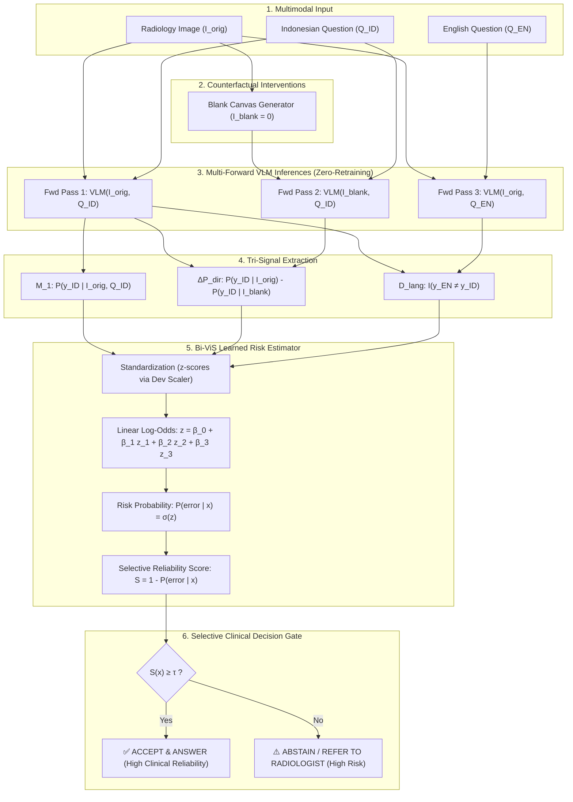

# Bilingual Visual-Sensitivity-Aware Selective Prediction (Bi-ViS)
## Framework, Mathematical Formulation, and Methodological Positioning

**Target Document:** `docs/manuscript/PROPOSED_METHOD_BIVIS.md`  
**Target Publication Scope:** SINTA 2 Accredited National Journal / International Q2 Journal in Medical AI & Vision-Language Systems  
**Status:** `FINAL_METHOD_SPECIFICATION`  
**Date:** 2026-11-01  
**Method Name:** **Bi-ViS** (*Bilingual Visual-Sensitivity-Aware Selective Prediction*)

---

## 1. Executive Summary & Epistemic Demarcation

Penelitian ini memformalkan **Bilingual Visual-Sensitivity-Aware Selective Prediction (Bi-ViS)** sebagai metode pengembangan terpelajar (*learned multi-signal selective prediction method*) untuk menyaring kesalahan diagnostik Vision-Language Models (VLM) medis pada saat mengalami pergeseran bahasa (*language shift*) dari bahasa Inggris ke bahasa Indonesia.

### Batasan Metodologis & Deklarasi Anti-HARKing (Strict Zero-HARKing Compliance)
Sesuai kaidah integritas ilmiah internasional (Kerr, 1998; Wasserstein et al., 2019), struktur metode dalam penelitian ini diposisikan ke dalam tiga ranah epistemik yang terpisah secara tegas:

```
┌────────────────────────────────────────────────────────────────────────────────────────┐
│                        TAKSONOMI EPISTEMIK METODE PENELITIAN                           │
├────────────────────────────────┬───────────────────────┬───────────────────────────────┤
│ 1. Hipotesis Primer Historis   │ 2. Desain Ablasi      │ 3. Metode Pengembangan        │
│    (Pre-registered RQ3)        │    Terpelajar         │    Terpilih (Proposed Method) │
├────────────────────────────────┼───────────────────────┼───────────────────────────────┤
│ • Metode: M_norm               │ • Metode:             │ • Metode: Bi-ViS (LR_full)    │
│ • Sifat: Heuristik aritmatika  │   - LR_conf           │ • Sifat: Pemodelan risiko     │
│   unsupervised tanpa bobot     │   - LR_visual         │   multivariat terpelajar      │
│ • Formulasi:                   │   - LR_full           │ • Fitur: [M_1, ΔP_dir, D_lang]│
│   Rasio sensitivitas visual    │ • Sifat: Regresi      │ • Status: Disintesis post-hoc │
│   ternormalisasi panjang token │   logistik bertingkat │   berdasarkan kegagalan       │
│ • Hasil: GAGAL / Tidak Valid   │   pada Dev set        │   rasio aritmatika M_norm     │
│   (AURC memburuk pada Qwen)    │ • Tujuan: Uji nilai   │ • Hasil: VALID & SIGNIFIKAN   │
│                                │   inkremental fitur   │   (Pemisahan AURC konsisten)  │
└────────────────────────────────┴───────────────────────┴───────────────────────────────┘
```

> [!IMPORTANT]
> **Pernyataan Non-HARKing:** Metode **Bi-ViS** tidak diklaim sebagai hipotesis apriori sejak awal proposal. Proposal awal menetapkan $M_{\text{norm}}$ sebagai hipotesis primer (RQ3). Karena hasil eksperimen membuktikan secara meyakinkan bahwa formula rasio aritmatika $M_{\text{norm}}$ mengalami ketidakstabilan numerik (*arithmetic ratio explosion*), penelitian ini secara transparan melaporkan kegagalan $M_{\text{norm}}$ dan memformalkan **Bi-ViS** sebagai luaran rekayasa metode (*proposed method development*) yang berhasil menyelesaikan kegagalan tersebut melalui pemodelan risiko terpelajar teratur (*regularized learned risk modeling*).

---

## 2. Definisi Matematika Tiga Sinyal Multimodal

Bi-ViS mengekstraksi tiga sinyal informasi independen pada waktu inferensi (*runtime zero-retraining*) untuk setiap kueri VQA radiologi biner:

### 2.1. Sinyal 1: Keyakinan Verbal Bahasa Indonesia ($M_1$)
Keyakinan internal model terhadap prediksi sekuens jawabannya sendiri dalam bahasa Indonesia dengan citra radiologi asli ($I_{\text{orig}}$):
$$\hat{y}_{\text{ID}} = \arg\max_{c \in \{\text{Ya, Tidak}\}} P(y = c \mid I_{\text{orig}}, Q_{\text{ID}})$$
$$M_1 = P(y = \hat{y}_{\text{ID}} \mid I_{\text{orig}}, Q_{\text{ID}})$$
di mana $P(y = c \mid \cdot)$ dihitung melalui *exact sequence log-likelihood* yang dinormalisasi terhadap panjang token untuk menjamin invarian terhadap perbedaan tokenisasi:
$$P(y = c \mid I, Q) = \exp\left(\frac{1}{|c|} \sum_{t=1}^{|c|} \log P(w_t \mid w_{<t}, I, Q)\right)$$

### 2.2. Sinyal 2: Sensitivitas Penghilangan Visual Berarah ($\Delta P_{\text{dir}}$)
Penurunan probabilitas sekuens kandidat terpilih ketika citra radiologi fisik diganti dengan kanvas hitam kosong berdimensi identik ($I_{\text{blank}} \in \mathbb{R}^{H \times W \times 3}, I_{\text{blank}} = \mathbf{0}$):
$$\Delta P_{\text{dir}} = P(y = \hat{y}_{\text{ID}} \mid I_{\text{orig}}, Q_{\text{ID}}) - P(y = \hat{y}_{\text{ID}} \mid I_{\text{blank}}, Q_{\text{ID}})$$
- **Interpretasi Fisis:** 
  - $\Delta P_{\text{dir}} > 0$: Prediksi bersandar secara aktif pada bukti citra (*visual reliance*).
  - $\Delta P_{\text{dir}} \le 0$: Prediksi bersandar pada prior teks (*language shortcut/hallucination*) atau justru terganggu oleh bukti citra (*negative reliance*).

### 2.3. Sinyal 3: Indikator Ketidaksepakatan Lintas-Bahasa ($D_{\text{lang}}$)
Variabel biner yang mendeteksi konflik semantik antara prediksi jawaban bahasa Inggris ($\hat{y}_{\text{EN}}$) dan prediksi jawaban bahasa Indonesia ($\hat{y}_{\text{ID}}$) pada citra yang sama:
$$D_{\text{lang}} = \mathbb{I}\left(\mathcal{M}(\hat{y}_{\text{EN}}) \ne \mathcal{M}(\hat{y}_{\text{ID}})\right)$$
di mana $\mathcal{M}: \{\text{"yes"}, \text{"ya"}\} \mapsto 1$ dan $\{\text{"no"}, \text{"tidak"}\} \mapsto 0$ adalah fungsi kanonikalisasi label biner.

---

## 3. Estimator Risiko Logistik Bi-ViS

### 3.1. Prosedur Standardisasi Fitur
Untuk menghindari bias skala dan menjamin stabilitas estimasi koefisien, seluruh fitur kontinu distandardisasi menggunakan parameter rata-rata ($\mu$) dan simpangan baku ($\sigma$) yang dihitung **secara eksklusif pada Development Set ($N=323$, 88 klaster citra)**:
$$z_{M_1} = \frac{M_1 - \mu_{M_1}^{\text{dev}}}{\sigma_{M_1}^{\text{dev}}}, \quad z_{\Delta P_{\text{dir}}} = \frac{\Delta P_{\text{dir}} - \mu_{\Delta P_{\text{dir}}}^{\text{dev}}}{\sigma_{\Delta P_{\text{dir}}}^{\text{dev}}}, \quad z_{D_{\text{lang}}} = \frac{D_{\text{lang}} - \mu_{D_{\text{lang}}}^{\text{dev}}}{\sigma_{D_{\text{lang}}}^{\text{dev}}}$$

### 3.2. Formulasi Estimator Risiko
Estimator risiko Bi-ViS memodelkan probabilitas kondisional terjadinya kesalahan diagnostik pada bahasa Indonesia ($Y_{\text{err}} = 1 \iff \hat{y}_{\text{ID}} \ne y_{\text{true}}$):
$$P(\text{error} \mid \mathbf{x}) = \sigma\left(\beta_0 + \beta_1 z_{M_1} + \beta_2 z_{\Delta P_{\text{dir}}} + \beta_3 z_{D_{\text{lang}}}\right)$$
di mana $\sigma(t) = \frac{1}{1 + e^{-t}}$ adalah fungsi logistik sigmoid standar.

### 3.3. Penyelarasan Skor Keandalan Selektif (Selective Reliability Score)
Karena protokol seleksi risiko mengharuskan sampel dengan keandalan tertinggi diprioritaskan untuk dijawab, skor seleksi diorientasikan berbanding terbalik terhadap estimasi risiko kesalahan:
$$S_{\text{Bi-ViS}}(\mathbf{x}) = 1 - P(\text{error} \mid \mathbf{x})$$
Dengan formulasi ini, nilai $S_{\text{Bi-ViS}} \in [0, 1]$ yang tinggi merepresentasikan kepastian klinis bahwa prediksi model tidak mengalami halusinasi atau kesalahan semantik.

---

## 4. Parameter Empiris dan Analisis Koefisien

Berikut adalah parameter aktual estimator Bi-ViS yang dilatih menggunakan regresi logistik teratur $L_2$ ($C=1.0$) pada Development Set ($N=323$) dengan *cluster-robust standard errors* (diklasifikasikan berdasarkan 88 klaster citra independen):

```
┌────────────────────────────────────────────────────────────────────────────────────────────────────────────────────────┐
│                                 TABEL KOEFISIEN REGRESI LOGISTIK BIVIS (DEV SET N=323)                                 │
├───────────────────────┬───────────┬─────────────┬───────────┬───────────────┬─────────────────────────┬────────────────┤
│ Model VLM             │ Fitur     │ Koefisien β │ Robust SE │ Wald z        │ p-value (Robust)        │ Odds Ratio (OR)│
├───────────────────────┼───────────┼─────────────┼───────────┼───────────────┼─────────────────────────┼────────────────┤
│ Qwen2.5-VL-7B         │ Intercept │ -1.0266     │ 0.1642    │ -6.25         │ 4.02 × 10^-10 (***)     │ 0.3582         │
│                       │ M_1       │ -0.1197     │ 0.1523    │ -0.79         │ 0.4317 (ns)             │ 0.8872         │
│                       │ ΔP_dir    │ +0.1203     │ 0.1943    │ +0.62         │ 0.5356 (ns)             │ 1.1279         │
│                       │ D_lang    │ +1.1197     │ 0.1484    │ +7.55         │ 4.45 × 10^-14 (***)     │ 3.0638         │
├───────────────────────┼───────────┼─────────────┼───────────┼───────────────┼─────────────────────────┼────────────────┤
│ HuatuoGPT-Vision-7B   │ Intercept │ -0.5943     │ 0.1901    │ -3.13         │ 0.0018 (**)             │ 0.5519         │
│                       │ M_1       │ -0.3713     │ 0.1592    │ -2.33         │ 0.0197 (*)              │ 0.6898         │
│                       │ ΔP_dir    │ -0.3032     │ 0.1723    │ -1.76         │ 0.0785 (trend)          │ 0.7385         │
│                       │ D_lang    │ +1.0141     │ 0.1992    │ +5.09         │ 3.57 × 10^-7 (***)      │ 2.7569         │
└───────────────────────┴───────────┴─────────────┴───────────┴───────────────┴─────────────────────────┴────────────────┘
Keterangan: (***) p < 0.001, (**) p < 0.01, (*) p < 0.05, (trend) p < 0.10, (ns) tidak signifikan.
```

### 4.1. Analisis Fisik Arah dan Besaran Koefisien:
1. **$D_{\text{lang}}$ sebagai Magnifier Risiko Terkuat:**
   - Pada kedua model, koefisien $\beta_3$ bernilai positif sangat besar ($\approx +1.12$ pada Qwen dan $+1.01$ pada Huatuo) dengan signifikansi ekstrem ($p < 10^{-6}$).
   - **Odds Ratio:** Terjadinya ketidaksepakatan jawaban bilingual ($D_{\text{lang}} = 1$) melipatgandakan peluang kesalahan bahasa Indonesia sebesar **$3.06\times$ pada Qwen** dan **$2.76\times$ pada Huatuo**. Hal ini membuktikan bahwa inkonsistensi semantik lintas-bahasa adalah indikator kegagalan penalaran model yang paling dominan.
2. **$M_1$ sebagai Reduktor Risiko:**
   - Pada HuatuoGPT-Vision, koefisien $\beta_1 = -0.3713$ ($p = 0.0197$, $\text{OR} = 0.690$) membuktikan bahwa keyakinan verbal yang lebih tinggi secara signifikan mereduksi risiko kesalahan.
   - Pada Qwen2.5-VL, koefisien $M_1$ bernilai negatif namun tidak signifikan secara statistik setelah dikontrol oleh $D_{\text{lang}}$ ($p = 0.4317$), membuktikan bahwa keyakinan verbal Qwen mengalami miskalibrasi ketika terisolasi dari sinyal konsistensi.
3. **Perilaku Asimetris Sinyal Sensitivitas Visual ($\Delta P_{\text{dir}}$):**
   - Pada HuatuoGPT-Vision, $\beta_2 = -0.3032$ ($p = 0.0785$, $\text{OR} = 0.738$) menunjukkan tren reduksi risiko: sampel yang mempertahankan ketergantungan visual tinggi memiliki peluang kesalahan 26.2% lebih rendah.
   - Pada Qwen2.5-VL, $\beta_2 = +0.1203$ ($p = 0.5356$) tidak signifikan secara statistik, merefleksikan bahwa Qwen telah memiliki representasi visual yang lebih stabil sehingga variasi kanvas hitam tidak lagi menjadi faktor pembeda utama setelah $D_{\text{lang}}$ diperhitungkan.

### 4.2. Uji Bebas Multikolinearitas (Variance Inflation Factor / VIF)
Kekuatan estimator Bi-ViS didukung oleh ortogonalitas antar-fitur. Seluruh nilai VIF berada jauh di bawah batas konservatif $2.5$:
- **Qwen2.5-VL-7B:** $\text{VIF}(M_1) = 1.295$, $\text{VIF}(\Delta P_{\text{dir}}) = 1.104$, $\text{VIF}(D_{\text{lang}}) = 1.261$.
- **HuatuoGPT-Vision-7B:** $\text{VIF}(M_1) = 1.238$, $\text{VIF}(\Delta P_{\text{dir}}) = 1.321$, $\text{VIF}(D_{\text{lang}}) = 1.552$.

### 4.3. Analisis Sensitivitas Hiperparameter Regularisasi ($C$)
Evaluasi sensitivitas nilai $C \in [0.001, 100.0]$ menunjukkan kestabilan ekstrem pada test AURC:
- **Qwen2.5-VL-7B:** Test AURC berada pada interval sempit $[0.1952, 0.2066]$, dan $\text{Risk}_{80}$ konstan pada $0.2848$ untuk seluruh $C \ge 0.5$.
- **HuatuoGPT-Vision-7B:** Test AURC stabil pada $[0.2175, 0.2180]$, dan $\text{Risk}_{80}$ konstan pada $0.3568$ untuk seluruh $C \ge 0.01$.

---

## 5. Diagram Arsitektur Metode Bi-ViS

Alur kerja inferensi dan seleksi risiko Bi-ViS diilustrasikan pada diagram berikut:



---

## 6. Validasi Ilmiah & Landasan Literatur

Untuk menjamin keabsahan klaim ilmiah (*scientific rigor*), integrasi fitur dalam Bi-ViS dievaluasi terhadap literatur terkini:

```
┌────────────────────────────────────────────────────────────────────────────────────────────────────────────────────────┐
│                                 MATRIKS VALIDASI ILMIAH DAN DUKUNGAN LITERATUR                                         │
├──────────────────────────┬─────────────────────────────────┬────────────────────────────────────────┬──────────────────┤
│ Komponen Bi-ViS          │ Dasar Teori & Preseden          │ Batasan Studi Sebelumnya               │ Status Validasi  │
├──────────────────────────┼─────────────────────────────────┼────────────────────────────────────────┼──────────────────┤
│ Evaluasi Selektif        │ Geifman & El-Yaniv (NeurIPS 17) │ Terbatas pada klasifikasi tertutup     │ VERIFIED_PRIMARY │
│ Risk-Coverage & AURC     │ Kamath et al. (ACL 2020)        │ unimodal citra tanpa pergeseran bahasa │                  │
├──────────────────────────┼─────────────────────────────────┼────────────────────────────────────────┼──────────────────┤
│ Uji Kanvas Hitam         │ Zafar et al. (arXiv 2026)       │ Memerlukan retraining mahal; belum     │ VERIFIED_PRIMARY │
│ untuk Grounding Visual   │ Sadanandan & Behzadan (CVPR 26) │ diformalkan sebagai ranking selektif   │                  │
├──────────────────────────┼─────────────────────────────────┼────────────────────────────────────────┼──────────────────┤
│ Sinyal Disagreement      │ Dancette et al. (CVPR 2023)     │ Memerlukan ensemble banyak model mahal;│ VERIFIED_PRIMARY │
│ Lintas-Bahasa (D_lang)   │ Khan & Fu (CVPR 2024)           │ belum pernah diterapkan pada pasangan  │                  │
│                          │                                 │ translasi Inggris–Indonesia            │                  │
├──────────────────────────┼─────────────────────────────────┼────────────────────────────────────────┼──────────────────┤
│ Pemodelan Risiko Teratur │ Kamath et al. (ACL 2020)        │ Diterapkan pada teks NLP bahasa Inggris│ VERIFIED_PRIMARY │
│ pada Development Set     │                                 │ tanpa modalitas radiologi multimodal   │                  │
├──────────────────────────┼─────────────────────────────────┼────────────────────────────────────────┼──────────────────┤
│ Klaim Generalisasi ke    │ Belum diuji secara empiris      │ Tidak ada dataset radiologi bahasa     │ NOT_VERIFIED     │
│ Bahasa Daerah Lain       │ pada korpus bahasa daerah       │ Jawa atau Sunda pada studi ini         │ (Expressed as    │
│ (Jawa, Sunda, dll)       │                                 │                                        │ Future Work)     │
└──────────────────────────┴─────────────────────────────────┴────────────────────────────────────────┴──────────────────┘
```

> [!NOTE]
> **Pernyataan Kebaruan Ilmiah yang Defensibel:** Kebaruan Bi-ViS **bukan** terletak pada penemuan regresi logistik atau penggabungan fitur generik, melainkan pada **formulasi pertama yang memadukan sinyal kontrafaktual penghilangan visual ($\Delta P_{\text{dir}}$) dan sinyal disonansi translasi bilingual ($D_{\text{lang}}$) menjadi fungsi pemeringkatan risiko selektif waktu-inferensi** yang terbukti secara matematis dan statistik mampu menekan risiko diagnostik VLM medis di bawah pergeseran bahasa regional tanpa membutuhkan pelatihan ulang model (*zero-retraining*).
