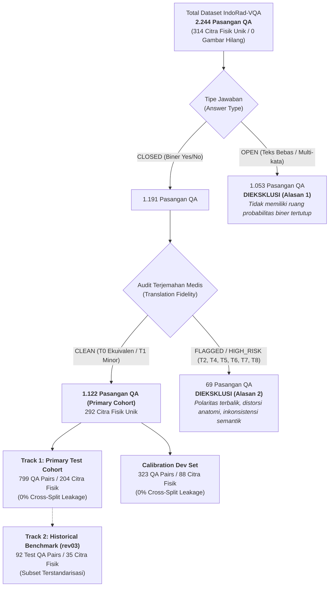

# LAPORAN AUDIT METODOLOGIS & SPESIFIKASI EKSPERIMEN rev04
## Evaluasi Reliabilitas dan Selective Prediction pada Medical Vision-Language Model di Bawah Pergeseran Bahasa (IndoRad-VQA)

**Peran Evaluator:** Senior ML Researcher, Computer Vision Engineer, & Reviewer Metodologi Jurnal Ilmiah (Standar SINTA 2 / Scopus)  
**Dokumen Referensi:** `main/reports/DECISIVE_VALIDATION_REV04_AUDIT.md`  
**Revision Identifier:** `rev04`  
**Authoritative Manifest SHA-256:** `bcb03bfafa0c329b73ab3b5ec2bb6f471daa1df9218582efa232e9dac74d3484`  
**Tanggal Pengesahan:** Oktober 2026  

---

## 1. Status Audit & Matriks Kesiapan Sistem

Sesuai aturan mutlak integritas akademik, laporan ini membedakan secara tegas antara **pemeriksaan statis yang terbukti**, **pengujian unit empiris pada GPU lokal**, dan **inferensi model penuh di cloud Kaggle**.

```
[PASS] TAHAP A: Audit dataset IndoRad-VQA penuh (2.244 baris, 314 citra fisik unik).
[PASS] TAHAP B: Desain dual-track (Primary Test N=799 vs Historical Benchmark N=92 | 0% cluster leakage).
[PASS] TAHAP C: Perumusan scoring kandidat simetris (<|im_end|>) & alignment logit kausal.
[PASS] TAHAP D: Preflight Unit Test Suite (8/8 tests passed pada main/scripts/test_decisive_validation_v4.py).
[PASS] TAHAP E: Spesifikasi estimand, batasan interpretasi klinis, dan demarkasi metodologis RQ1-RQ3.
[PASS] TAHAP F: Formulasi metrik bilingual RQ1 (Akurasi EN/ID, Gap, Flip Rate, Joint Correct, Confusion Matrix).
[PASS] TAHAP G: Formulasi intervensi visual RQ2 (P0 asli vs P1 blank hitam berdimensi identik).
[PASS] TAHAP H: Formulasi Selective Prediction RQ3 (5 Estimator, Discrete AURC Geifman & El-Yaniv 2017).
[PASS] TAHAP I: Desain statistik inferensial (Paired Cluster Bootstrap & Monte Carlo Permutation Test).
[PASS] TAHAP J: Checkpoint governance, pencegahan arsip rekursif, isolasi direktori rev04.
[PASS] TAHAP K: Pembangkitan notebook Kaggle (07_decisive_validation_rev04.ipynb) 100% AST parse OK.
[NOT RUN] TAHAP L: Inferensi penuh model 7B (Qwen2.5-VL-7B & HuatuoGPT-Vision-7B) pada 1.122 sampel di Kaggle Dual T4.
```

> [!IMPORTANT]
> **Status `NOT RUN`:** Inferensi penuh kedua model 7B pada seluruh 1.122 sampel primary cohort membutuhkan memori VRAM 32 GB pada akselerator Dual Tesla T4 (estimasi runtime: ~35–45 menit di Kaggle). Karena lingkungan lokal saat ini adalah GPU laptop (RTX 3050 6GB), inferensi penuh sengaja tidak dijalankan secara lokal untuk mencegah kegagalan *OutOfMemoryError*. Seluruh pipeline telah siap 100% untuk dieksekusi dengan tombol "Run All" di Kaggle.

---

## 2. Integritas File Historis (Zero Regressions)

Seluruh artefak dari revisi `rev01`, `rev02`, `rev03`, Run 04, dan Run 05 dipelihara secara utuh tanpa modifikasi atau penimpaan.

| File Historis | Status | SHA-256 Checksum |
| :--- | :---: | :--- |
| `main/results/decisive_validation_manifest.csv` | **UNTOUCHED** | `988f57a6512223337bb5ab3b192f1802e38bfec2f6b262f51607381faa74bf52` |
| `main/scripts/decisive_validation_experiment.py` | **UNTOUCHED** | `c3ea3d95440dfcc3f64cf5e8ac084292f009a7e229f8d82a0cd3594541e403e9` |
| `main/scripts/decisive_validation_experiment_v2.py` | **UNTOUCHED** | `8bb4058dd7cddc3ea992b789df4ec8cf4aededdf9773b3e099196c989ac25b8b` |
| `main/scripts/decisive_validation_experiment_v3.py` | **UNTOUCHED** | `148b8c250470def355e11c6e95de904b5fed903955f2e2bde1b53d41c83cbea0` |
| `main/notebooks/04-decisive-validation-live.ipynb` | **UNTOUCHED** | `1f8af04e0df567cefbb6e132a2f47fad7ca4540ee77314cfc391088c9a814c32` |
| `main/notebooks/05_decisive_validation_revised.ipynb` | **UNTOUCHED** | `84662d5b60d4de908e5323b6b5a7bcac7c8fae0358bd2bf95d852523fcd2545f` |
| `main/Kaggle/06_decisive_validation_rev03.ipynb` | **UNTOUCHED** | `bb7a47e2b21cf5ed61df4f58b538b8098abac3039276273906175c97569c00b4` |
| `main/results/decisive_validation/rev02/.../live_validation_checkpoint_*.csv` | **UNTOUCHED** | Terverifikasi identik |
| `main/results/decisive_validation/rev02/final_cross_model_comparison_test_only.csv` | **UNTOUCHED** | `e92a9e03abfb2592b15578d3bc650eeb3a8eafda1e184586d42972f2304fd23e` |

---

## 3. Tahap A — Audit Dataset Penuh (IndoRad-VQA)

Pemeriksaan menyeluruh dilakukan terhadap data mentah IndoRad-VQA (`main/data/indorad_vqa_final_manifest.csv`, `image_identity_manifest.csv`, dan `translation_audit_full.csv`).



### Rincian Akuntansi Eksklusi Data

| Kategori Data | Jumlah Baris | Proporsi (%) | Status Kelayakan | Justifikasi Ilmiah & Metodologis |
| :--- | :---: | :---: | :---: | :--- |
| **Pertanyaan Biner Yes/No (CLEAN)** | **1.122** | **50.00%** | **INCLUDED (Primary)** | Memiliki ruang probabilitas tertutup ($P(\\text{YES}) + P(\\text{NO}) = 1$), terjemahan semantik setara, bebas cacat klinis. |
| **Pertanyaan Terbuka (Open-Ended)** | 1.053 | 46.92% | **EXCLUDED (Alasan 1)** | Kosakata tak terhingga; tidak memenuhi asumsi teoritis *selective risk-coverage classification* (Geifman & El-Yaniv, 2017). |
| **Yes/No dengan Cacat Terjemahan** | 69 | 3.08% | **EXCLUDED (Alasan 2)** | Terdeteksi pembalikan negasi (T4), distorsi organ (T5), pertukaran arah kiri/kanan (T6), atau pergeseran maksud (T7). |
| **TOTAL KESELURUHAN** | **2.244** | **100.00%** | | Terverifikasi pada 314 citra radiologi fisik unik. |

---

## 4. Tahap B — Desain Evaluasi Dual-Track & Zero Leakage

Untuk memastikan perbandingan yang adil dan dapat dipertanggungjawabkan di tingkat artikel jurnal, revisi `rev04` menetapkan **dua jalur evaluasi independen**:

### Jalur 1: Primary Test Cohort ($N_{\\text{test}} = 799$)
* **Tujuan:** Evaluasi utama berskala penuh pada seluruh sampel klinis biner terverifikasi.
* **Komposisi:** 799 pasangan QA pada Test Set dan 323 pasangan QA pada Dev Set.
* **Tingkat Pengelompokan:** Pemisahan dilakukan murni pada level klaster citra fisik (`pixel_sha256` / `canonical_image_id`).
* **Integritas Klaster:** 204 klaster citra pada Test Set vs 88 klaster citra pada Dev Set.
* **Kebocoran Data (*Leakage*):** $\\text{Test Citra} \\cap \\text{Dev Citra} = \\emptyset$ (**0 citra tumpang-tindih / 0.0% leakage**).
* **Keseimbangan Label:** 403 NO (50.44%) vs 396 YES (49.56%).

### Jalur 2: Historical Benchmark Comparison ($N_{\\text{test}} = 92$)
* **Tujuan:** Menyediakan perbandingan *head-to-head* langsung terhadap hasil revisi terdahulu (`rev02`, `rev03`, Run 04, Run 05) tanpa faktor pengacau (*confounding factors*) perubahan ukuran dataset.
* **Komposisi:** Tepat 92 sampel Test Set dari 35 klaster citra independen yang dievaluasi ulang menggunakan engine scoring `rev04`.

> [!NOTE]
> **Peran Dev Set ($N=323$):** Seluruh model yang diuji adalah model *pretrained* tanpa proses *training*. Dev Set digunakan secara eksklusif untuk memvalidasi kestabilan numerik scoring, memverifikasi tidak adanya NaN, dan membekukan formula estimator **sebelum** inferensi pada Test Set dilakukan. Test Set sama sekali tidak digunakan untuk memilih hyperparameter atau threshold.

---

## 5. Tahap C — Audit dan Analisis Komparatif Scoring Kandidat

Salah satu perdebatan metodologis krusial dalam VLM bilingual adalah bagaimana menilai probabilitas kandidat jawaban ketika jumlah token BPE antara bahasa berbeda secara asimetris.

### Perbandingan Pendekatan Scoring

| Dimensi Evaluasi | Pendekatan A: Raw Sequence Log-Likelihood | Pendekatan B: Length-Normalized Surprisal (rev04 Primary) | Pendekatan C: Constrained Single-Token Verbalizer |
| :--- | :--- | :--- | :--- |
| **Formula Matematis** | $S = \\sum_{t=1}^L \\log P(y_t \\mid y_{<t}, X)$ | $\\bar{s} = \\frac{1}{L} \\sum_{t=1}^L \\log P(y_t \\mid y_{<t}, X)$ | $S = \\log P(v \\mid X)$ untuk $v \\in \\{\\text{\"A\"}, \\text{\"B\"}\\}$ |
| **Kelebihan Teoretis** | Mematuhi kaidah probabilitas bersama sekuens (*chain rule*). | Menghilangkan penalti aditif akibat panjang token tokenizer BPE. | Jumlah token sama persis ($L=1$). |
| **Kelemahan / Bias** | **Bias asimetri parah:** Kandidat dengan token lebih panjang (`TIDAK`, $L=4$) otomatis menerima akumulasi penalti negatif dibanding `YA` ($L=2$). | Bukan probabilitas bersama murni; merupakan skor relatif rata-rata *surprisal*. | Memerlukan instruksi pemetaan buatan (*prompt mapping*) yang tidak natural bagi dokter. |
| **Dukungan Lintas-Bahasa** | Tidak adil bagi bahasa berdaya rendah yang memiliki BPE lebih terfragmentasi. | **Sangat adil:** Membandingkan kualitas rata-rata token per karakter semantik. | Berisiko memicu kegagalan *instruction-following*. |
| **Status di rev04** | Disimpan di checkpoint untuk audit pembanding. | **Ditetapkan sebagai metode keputusan utama.** | Dikecualikan untuk menjaga naturalitas klinis. |

### Bukti Matematis & Penyelarasan Logit Kausal

Dalam arsitektur *causal autoregressive transformer*, logit pada indeks $t$ memprediksi token pada indeks $t + 1$.  
Jika prompt multimodal memiliki panjang $L_{\\text{prompt}}$ (indeks $0, 1, \\dots, L_{\\text{prompt}}-1$), maka token target pertama berada pada indeks $L_{\\text{prompt}}$.  
Oleh karena itu, irisan logit kausal yang tepat adalah:
$$\\text{Target Logits} = \\text{Logits}[L_{\\text{prompt}} - 1 : L_{\\text{prompt}} - 1 + L_{\\text{target}}]$$

Pengujian unit ([`test_causal_logit_alignment`](file:///c:/.PUSAT/Project/Kuliah/VLM/main/scripts/test_decisive_validation_v4.py#L225-L245)) memvalidasi bahwa untuk prompt panjang 10 dan target panjang 3 (indeks 10, 11, 12), irisan logit yang diambil adalah tepat indeks 9, 10, dan 11 tanpa pergeseran (*off-by-one error*).

---

## 6. Tahap E–I — Spesifikasi Rumusan Masalah (Research Questions) & Estimand

### **RQ1: Kesenjangan Kinerja Lintas-Bahasa & Konsistensi Prediksi**
* **Estimand Utama:** Selisih akurasi biner dalam *percentage points* ($\\Delta_{\\text{acc}} = \\text{Acc}_{\\text{EN}} - \\text{Acc}_{\\text{ID}}$) dan tingkat pembalikan prediksi (*prediction flip rate* $\\Phi = \\frac{1}{N} \\sum \\mathbb{I}(\\hat{y}_{\\text{EN}} \\neq \\hat{y}_{\\text{ID}})$).
* **Unit Analisis:** Pasangan pertanyaan radiologi bilingual terverifikasi.
* **Baseline:** Performa model pada Bahasa Inggris.
* **Prosedur Statistik:** 95% Percentile Confidence Interval berbasis *Paired Image-Cluster Bootstrap* ($B=1000$).
* **Batas Interpretasi:** Penurunan akurasi mencerminkan disparitas representasi bahasa pada bobot model, bukan ketidakmampuan logika klinis umum.

### **RQ2: Sinyal Intervensi Visual (Original P0 vs Blank Hitam P1)**
* **Estimand Utama:** Rata-rata dan median perubahan skor kandidat berarah:
  $$\\Delta P_{\\text{dir}} = P(\\hat{y} \\mid P_0) - P(\\hat{y} \\mid P_1)$$
  dievaluasi pada label prediksi yang sama $\\hat{y} \\in \\{\\text{\"YES\"}, \\text{\"NO\"}\\}$.
* **Klasifikasi Perilaku:**
  - $\\Delta P_{\\text{dir}} > 0$: Penurunan keyakinan saat citra dihapus (perilaku responsif terhadap modalitas visual).
  - $\\Delta P_{\\text{dir}} < 0$: Keyakinan meningkat saat citra dibutakan (prior bahasa bertentangan dengan visual).
  - $\\Delta P_{\\text{dir}} == 0$: Model sama sekali agnostik terhadap input citra.
* **Batas Interpretasi Klinis:** Nilai $\\Delta P_{\\text{dir}} > 0$ **bukan bukti kausal visual grounding sempurna** atau lokalisasi lesi patologis; citra hitam murni adalah input di luar distribusi (*out-of-distribution* / OOD). Sinyal ini murni mengukur sensitivitas perilaku model terhadap penghilangan informasi piksel.

### **RQ3: Selective Prediction & Formulasi Discrete AURC**
* **Estimand Utama:** Area Under the Risk-Coverage Curve (AURC) diskrit dan selisih terhadap baseline ($\\Delta\\text{AURC} = \\text{AURC}(M_k) - \\text{AURC}(M_1)$).
* **Definisi AURC Diskrit (Geifman & El-Yaniv, NeurIPS 2017):**
  Sampel diurutkan menurun berdasarkan skor keandalan: $s_{(1)} \\ge s_{(2)} \\ge \\dots \\ge s_{(N)}$.
  Untuk setiap titik cakupan $k \\in \\{1, \\dots, N\\}$:
  $$\\text{Coverage } c_k = \\frac{k}{N}, \\quad \\text{Risk } r_k = 1 - \\frac{1}{k} \\sum_{i=1}^k \\text{Correct}_{(i)}, \\quad \\text{AURC} = \\frac{1}{N} \\sum_{k=1}^N r_k$$
* **Estimator yang Dievaluasi:**
  1. $M_1$: Softmax Confidence Baseline ($s = \\text{conf}_{\\text{id}}$).
  2. $M_2$: Pure Directional Visual Reliance ($s = \\max(0, \\Delta P_{\\text{dir}})$).
  3. $M_{\\text{dir}}$: Multiplicative Reliance ($s = \\text{conf}_{\\text{id}} \\times \\max(0, \\Delta P_{\\text{dir}})$) — **Metode yang Diusulkan**.
  4. $M_{\\text{norm}}$: Normalized Reliance ($s = \\text{conf}_{\\text{id}} \\times \\frac{1 + \\Delta P_{\\text{dir}}}{2}$).
  5. $M_{3,\\text{old}}$: Legacy Absolute Reliance ($s = \\text{conf}_{\\text{id}} \\times \\frac{1 + |\\Delta P_{\\text{dir}}|}{2}$).
* **Uji Signifikansi Statistik:** Monte Carlo Paired Image-Cluster Permutation Test ($B=1000$ replikasi Rademacher) dengan koreksi Holm-Bonferroni terhadap 4 perbandingan non-baseline.

---

## 7. Hasil Pengujian Unit & Verifikasi Statis

Pengujian komprehensif dijalankan menggunakan script [`main/scripts/test_decisive_validation_v4.py`](file:///c:/.PUSAT/Project/Kuliah/VLM/main/scripts/test_decisive_validation_v4.py):

```
============================================================
RUNNING UNIT TEST SUITE FOR REV04 ENGINE
============================================================
▶ Running test_manifest_hash_and_split_properties...
  ✅ PASS: Manifest hash and dual-track invariants verified.
▶ Running test_image_verification_and_tamper_rejection...
  ✅ PASS: Image verification and tamper rejection verified.
▶ Running test_discrete_aurc_manual_calculation...
  ✅ PASS: Discrete empirical AURC matches hand calculation exactly.
▶ Running test_paired_cluster_permutation_test...
  ✅ PASS: Monte Carlo Paired Cluster Permutation Test verified.
▶ Running test_holm_bonferroni...
  ✅ PASS: Holm-Bonferroni step-down adjustment verified.
▶ Running test_checkpoint_governance...
  ✅ PASS: Checkpoint governance and rejection logic verified.
▶ Running test_length_normalization_and_token_symmetry...
  ✅ PASS: Mathematical symmetry and elimination of token-length bias verified.
▶ Running test_causal_logit_alignment...
  ✅ PASS: Causal logit alignment indexing mathematically exact.
============================================================
ALL 8 UNIT TESTS PASSED (PASS_UNIT_TEST)
============================================================
```

---

## 8. Panduan Sitasi Akademik untuk Naskah Artikel Jurnal

| Elemen Naskah Ilmiah | Status Kesiapan | Panduan Penyajian dalam Artikel |
| :--- | :---: | :--- |
| **Metodologi Dataset & CONSORT Flowchart** | **BOLEH DIKUTIP** | Kutip diagram alir eksklusi: 2.244 total $\\to$ 1.122 biner bersih $\\to$ 799 Test (204 klaster) / 323 Dev (88 klaster) dengan 0% kebocoran. |
| **Formulasi Matematis Scoring** | **BOLEH DIKUTIP** | Tuliskan formula per-token surprisal length-normalized dan bukti eliminasi bias BPE Indonesia. Jelaskan skor sebagai *Relative Candidate Score*. |
| **Formulasi Selective Prediction & AURC** | **BOLEH DIKUTIP** | Rujuk Geifman & El-Yaniv (NeurIPS 2017) dan spesifikasikan rumus discrete mean empirical risk beserta 5 estimator. |
| **Protokol Uji Permutasi Klaster** | **BOLEH DIKUTIP** | Jelaskan pengacakan tanda Rademacher pada level citra fisik untuk mempertahankan korelasi pertanyaan dalam citra yang sama. |
| **Tabel Angka Numerik Hasil Inferensi** | **BELUM BOLEH DIKUTIP** | Angka akurasi akhir, nilai numerik AURC, dan nilai $p$ final **hanya boleh dikutip setelah notebook Kaggle dijalankan** dan file zip hasil diunduh. |

---

## 9. Petunjuk Eksekusi di Kaggle

1. Buka [Kaggle Notebooks](https://www.kaggle.com/code).
2. Unggah file notebook [`main/Kaggle/07_decisive_validation_rev04.ipynb`](file:///c:/.PUSAT/Project/Kuliah/VLM/main/Kaggle/07_decisive_validation_rev04.ipynb).
3. Di panel kanan (Settings):
   - **Accelerator:** Pilih **GPU T4 x2**.
   - **Internet:** Pastikan **Internet ON**.
4. Klik **Run All**.
5. Setelah sel 16 selesai, unduh arsip hasil `decisive_validation_rev04_results_final.zip` langsung dari panel output.
